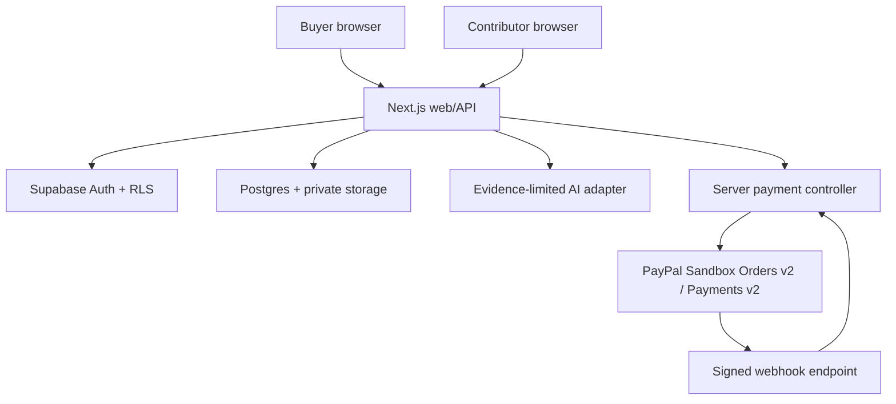

# MilestonePay AI — Architecture (planned, not implemented)

## System boundary

## Layer contract
| Layer | Planned technology | Authority |
| --- | --- | --- |
| UI | Next.js + TypeScript | Renders records and consent; never sets merchant or amount |
| Auth/data | Supabase Auth, Postgres RLS | Buyer/contributor isolation; frozen criteria/evidence snapshots |
| AI | Google Gemini 3.8 Flash (`gemini-3.8-flash`), planned `@google/genai` server adapter, medium thinking and strict JSON | Advisory criteria suggestions and evidence assessment only; zero payment tools |
| Payments | Server-only PayPal REST, JS SDK buyer approval | One fixed Sandbox merchant, USD, one full capture |
| Audit | Append-only event history | Records data/source provenance; not a bank ledger |
| QA | Vitest, Playwright, sandbox harness | Negative controls + verified real external transactions |

## Payment orchestration
1. Backend freezes buyer-agreed amount/criteria (integer cents and hash).
2. Backend creates PayPal Orders v2 AUTHORIZE order with trusted amount and fixed merchant.
3. Buyer approves via official PayPal JS SDK; backend checks ownership/order state and authorizes.
4. Contributor submits versioned evidence; AI returns structured assessment with real evidence references; no AI payment capability.
5. Buyer separately reviews exact amount/payee, affirms capture consent, and clicks to proceed.
6. Backend atomically reserves a stable-idempotency capture operation, captures via Payments v2, and reconciles provider-confirmed result. Alternative path is buyer-initiated void.
7. Only signed, verified, deduplicated PayPal events can update payment status. Timeout/unresolved means UNKNOWN and capture controls disabled.

Never claim PayPal authorization creates escrow. No partial/multiple capture, seller routing, payouts, live host or production credentials.

## Trust boundaries and threat controls
- Every change is authenticated, authorized by server ownership + role, and subject to RLS.
- Client/AI/screenshot/evidence content are untrusted and cannot determine payment provider operations.
- AI prompt injection has no access to capture/void tools; invalid citations/outputs fail closed.
- External evidence URLs are displayed as untrusted references; never server-fetched (SSRF).
- Webhooks require signature verification on raw payload, correct webhook ID, event uniqueness and matching provider objects.
- Provider timeouts reconcile before retrial; persist operation identifiers before network activity.
- Storage restricts MIME, size, access policies and retention; no personally identifying real customer evidence.

## Lifecycle
Local synthetic fixture → authorized developer-only Sandbox testing → independent security audit → owner-approved public hackathon demo. Production payment operation is **out of scope**.

See `docs/ADR-001-SINGLE-MERCHANT.md` and `docs/MILESTONEPAY-SPEC-v1.md`. No database migrations or routes have been implemented as of MP-A0.

## AI integration boundary (design, not deployed)
See `docs/ADR-002-GEMINI-PRIMARY.md` and `docs/AI-VERIFICATION-CONTRACT.md` for versioned inputs, current evidence citations, strict output validation, disabled tools and error behavior. AI never writes payment state or enables capture independently of authenticated buyer consent. No real model call has been executed.
