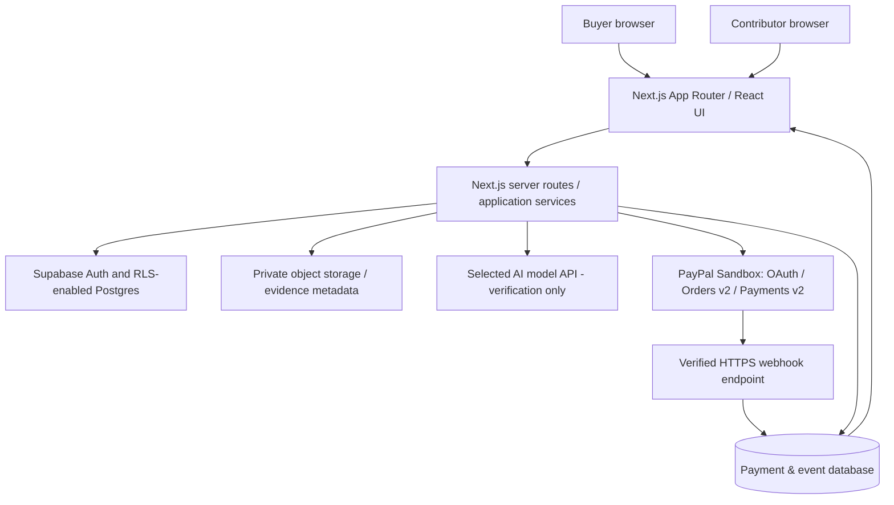

# MilestonePay AI — Hackathon Product & Engineering Specification

**Version:** 1.0 (planning draft)  
**Prepared:** October 24, 2026  
**Build window:** October 25–November 11, 2026 (18 calendar days inclusive)  
**Submission buffer:** November 12, 2026 (Philippines)  
**Hackathon submission deadline:** November 12, 2026 at 12:00 noon PST = November 13, 2026 at 4:00 AM PHT  
**Repository:** `mrdzyn/milestonepay-ai` (created from the AI-native project template; implementation not begun)  
**Proposed license:** MIT, contingent on a dependency/license review  
**Status:** SPECIFICATION ONLY. No code, PayPal transactions, tests, audit, deployment, or submission are claimed complete.

> **Non-negotiable product boundary:** This is a single merchant's PayPal Sandbox checkout with human-approved delayed capture. It is NOT escrow, a trust account, a payment guarantor, a marketplace, a dispute-arbitration service, or a mechanism for paying unrelated third-party contractors. PayPal, not MilestonePay AI, holds and processes payment authorizations. The buyer approves capture explicitly; AI cannot capture or void funds.

## 1. Executive definition

**Tagline:** Verify the work. Approve the payment. Trust the process.

**One-sentence pitch:** MilestonePay AI turns a work agreement into evidence-backed acceptance checks and connects those results to a real PayPal Sandbox authorization-and-capture workflow—while keeping the final payment decision in the buyer's hands.

**Problem:** Buyers cannot reliably determine whether digital deliverables meet a brief, and service providers lack clear, understandable acceptance criteria. Simple payment buttons move money without linking a payment decision to a structured, reviewable delivery report.

**Proposed solution:** The buyer drafts a single, short delivery milestone for a fixed USD price; AI suggests acceptance criteria; the buyer freezes the criteria and authorizes payment using PayPal Sandbox; a contributor submits text evidence and a controlled attachment; AI classifies the evidence by criterion with citations and uncertainty; a buyer explicitly accepts and captures or declines and voids the authorization. A visible timeline distinguishes AI opinion, buyer decision, and PayPal-confirmed payment status.

**Target user:** A *single service-selling merchant* providing milestone-based digital work to a buyer; the second UI persona is the contributor who submits evidence on that merchant's behalf. For the sandbox demo, both personas use synthetic accounts. No actual transfer to an independent contributor is implemented.

**Demo narrative:** A $20 sandbox website deliverable with three acceptance criteria. The seller/contributor supplies evidence, the AI returns PASS / GAP / UNVERIFIABLE with evidence references, and the buyer either approves capture or requests changes/voids. Judges see an actual PayPal sandbox order ID, authorization ID, capture ID, and a redacted audit log—not fabricated fixtures presented as real payment confirmations.

**Success statement:** From a fresh install, the judges can complete a real sandbox authorize → verification → explicit buyer approval → capture journey, plus a void journey, and can reproduce the adverse-case tests without private developer access.

## 2. Hackathon constraints and positioning

- Must meaningfully use PayPal APIs/SDKs and a functioning AI model/service; neither may be a decorative mock.
- Public open-source repository with source, license, clear setup, tests, and functional demo or reproducible local launch.
- Public YouTube video shorter than three minutes, showing real application behavior; English supporting materials.
- Describe actual model/provider/tools used and precisely how. Make no unsupported claims of accuracy, production readiness, fund protection, or official PayPal affiliation.
- Judges score technical implementation, design, potential impact, innovation, and presentation equally. An AG Grid sponsor submission is a stretch only if a meaningful analytics/dashboard experience can be completed *after* core payment gates.
- Keep public judge access available free of charge through the December 1–15, 2026 judging period, or provide verified, fully runnable setup instructions and sandbox-account guidance without distributing secrets.
- Relevant official rules: https://paypalaihackathon.devpost.com/rules and overview https://paypalaihackathon.devpost.com/ .

**Differentiator:** Most agentic payment demonstrations optimize how AI initiates payment. MilestonePay AI puts an explicit **evidence and human-consent gate** between payment authorization and settlement. The UX makes uncertainty visible and preserves payment-provider provenance.

## 3. Strict MVP scope

### P0: Required

1. **Single-merchant configuration:** one PayPal Sandbox REST app, one sandbox business merchant, one sandbox personal buyer; `PAYPAL_ENV=sandbox` hard-coded/allowlisted for demo; USD only; one milestone/order; fixed full amount, $1–$200 sandbox demo cap.
2. **Two authenticated application roles:** buyer and contributor, with server-enforced ownership and role policies; demo users are fictional. Merchant/payee is fixed to the configured business account, not the contributor's user profile.
3. **Milestone wizard:** name, brief, 2–5 measurable criteria, fixed price in integer cents, buyer editable before freezing. AI *suggests* criteria; buyer confirms them before PayPal authorization.
4. **PayPal payment path:** OAuth 2 client credentials; Orders v2 create `AUTHORIZE`; JS SDK approval with `intent=authorize`; server authorizes order; Payments v2 capture or void; retrieve/verify resulting IDs/status; sandbox webhook verification and idempotent reconciliation.
5. **Evidence submission:** contributor provides up to five short text entries; optionally one sanitized PNG/JPEG attachment up to 5 MB; hashes and access controls; each entry mapped to criteria. External URLs are references only and never auto-fetched.
6. **Actual AI verification:** model call against the frozen criterion snapshot and evidence; strict schema, confidence/uncertainty, evidence IDs, and reason per criterion. No claim of automated proof when evidence is absent.
7. **Human-controlled decision:** buyer sees report and evidence and can request revisions, explicitly authorize capture, or void an active authorization. No background or AI-initiated capture/void.
8. **Audit UI:** timestamped actor/action, criterion version hash, evidence hash, AI model/version, PayPal sandbox IDs/status, captured amount, reconciliation notes.
9. **Reliability/security:** tested idempotency and races; webhook signature verification; ownership, CSRF/origin checks, secrets redaction, error/retry states; minimum real sandbox negative-path proof.
10. **Judge readiness:** deploy or runnable local instructions; synthetic seeded scenarios; manual QA, independent review, final demo and Devpost artifacts.

### P1: Stretch, only after all P0 gates PASS

- AG Grid/AG Studio analytics dashboard with meaningful interactive drilldowns and a disclosed sponsor-tool integration (not merely a decorative table); use the sponsor's actual AG Studio requirements to decide eligibility.
- Compare revision-to-revision evidence and reason about what changed.
- Export redacted verification packet as downloadable JSON/PDF (never suggest legal enforceability).

### Explicitly out of scope

- Escrow, trust custody, balance holding, delayed disbursement, PayPal platform fees, marketplace onboarding, third-party payouts, KYC, live money, multi-merchant accounts, partial/multiple captures, refunds, split payments, subscriptions, disputes/arbitration, automation of cardholder payment approval, fully automated website penetration testing, production launch.
- Do not use the PayPal partner-specific `platform_fees`, `disbursement_mode`, or third-party `payee` routing features. The fixed business account receives a captured sandbox payment.

## 4. User stories and UI

**US-01 (buyer):** I can create a $20 job with frozen acceptance criteria that I can review before I authorize a PayPal payment.

**US-02 (contributor):** I can submit evidence against individual acceptance criteria but cannot edit the accepted criteria or capture/void a payment.

**US-03 (buyer):** I can see criterion-level results labeled `SUPPORTED`, `GAP`, or `UNVERIFIABLE`, each with a supporting evidence reference and plain-language explanation.

**US-04 (buyer):** I must explicitly click a confirm-capture control that displays the exact USD amount, merchant identity, and sandbox status; only then may the server contact PayPal to capture.

**US-05 (buyer):** I can void an uncaptured authorization. An authorization that is captured, voided, expired, or unresolved cannot be captured again through ordinary UI.

**US-06 (auditor/judge):** I can distinguish application decisions from verified PayPal events and inspect a redacted immutable event history.

**Screens:** (1) landing/demo disclaimer; (2) contract editor/freeze; (3) PayPal authorization checkout; (4) contributor evidence workbench; (5) buyer review and comparison; (6) payment status/timeline; (7) minimal demo/evidence panel. Desktop-first and responsive on mobile; visible keyboard focus, screen-reader labels, actionable errors, no color-only status.

**UX copy:** Always show `PayPal Sandbox — no real money`. Use `Authorized`, `Captured`, `Voided`, `Unknown/reconciling`; never say `funds secured`, `escrow funded`, `seller automatically paid`, or `payment guaranteed`.

## 5. Architecture



**Implementation choices:** Next.js + TypeScript + Tailwind/shadcn-compatible UI; Supabase Auth + Postgres with RLS; server-side PayPal REST client via `fetch` and fixed sandbox origin; one real text-capable AI provider/model with structured JSON responses (choose and document exact provider by Day 9); Vitest for units/integration; Playwright for browser and sandbox integration; optional Vercel/Render for hosting. Pin dependency versions and Node version in repo before implementation. If screenshots are enabled, use a verified vision-capable model and clear image-transmission consent, otherwise use text-only evidence.

**Trust boundaries:** Browser is untrusted; uploads and AI output are untrusted; PayPal is external authority for payment status; database policies are a second line of defense; authorization to capture is solely a backend-validated human action. Client-supplied order IDs, totals, actor IDs, AI verdicts, or payment states are never trusted.

**AI interface** (`VerificationResult`):

```json
{
  "contractVersionHash": "sha256:...",
  "evidenceManifestHash": "sha256:...",
  "model": "provider/model-name",
  "results": [
    {
      "criterionId": "criterion-1",
      "verdict": "SUPPORTED",
      "evidenceIds": ["evidence-1"],
      "reason": "The cited evidence states the delivered feature and includes a reproducible test result.",
      "limitations": "Not independently executed by the AI model."
    }
  ],
  "summary": "Two supported; one requires manual review."
}
```

Permitted verdicts: `SUPPORTED`, `GAP`, `UNVERIFIABLE`. `SUPPORTED` means **the supplied evidence supports the claim**, not that the software or deliverable is objectively proven correct. All model output is validated with a schema, criterion-ID allowlist, citation-ID membership, and a length bound; invalid output fails closed to `UNVERIFIABLE`/`ERROR`, never unlocks capture.

**No AI-to-payment tool link:** The AI model receives no OAuth token, capture endpoint, order credentials, or ability to invoke payment services. Its output is advisory and cannot write payment state. Even a perfect AI report cannot enable capture without buyer consent and all backend preconditions.

## 6. Data model and retention

Tables (UUID PK unless noted):

| Table | Key fields / invariants |
|---|---|
| `profiles` | `user_id`, `role` (`buyer`/`contributor`), demo fixture marker; app roles validated server-side |
| `contracts` | `buyer_id`, `contributor_id`, `title`, `brief`, `amount_cents` integer, `currency='USD'`, `status`, `current_version` |
| `criteria` | `contract_id`, `criterion_id`, order, text, frozen version/hash; 2–5 criteria; immutable after authorization |
| `payment_attempts` | `contract_id`, fixed merchant ID, `order_id` UNIQUE, `authorization_id` UNIQUE, `capture_id` UNIQUE nullable, status, cents, payee, authorized/expires times, request IDs, version |
| `evidence_items` | `contract_id`, criterion ID, owner, normalized text OR private storage key, SHA-256, MIME, size, timestamps |
| `verification_runs` | contract version hash, evidence manifest hash, provider/model, prompt revision, output JSON, status, duration, timestamps |
| `buyer_decisions` | actor, action (`REQUEST_CHANGES`, `APPROVE_CAPTURE`, `VOID`), amount, verification run ID, evidence hash, timestamp |
| `payment_operations` | `operation_key` UNIQUE, type, attempt ID, request ID UNIQUE, status (`INITIATED`, `SUCCEEDED`, `UNKNOWN`, `FAILED`), result IDs, timestamps |
| `webhook_events` | PayPal event ID UNIQUE, transmission ID, verified boolean, event type, bound resource IDs, processing result |
| `audit_events` | append-only actor, action, source, entity ID, timestamp, redacted JSON payload, optional previous-event digest |

**Concurrency:** Postgres transaction with conditional `UPDATE ... WHERE ...` or row-level lock (or one durable operation row with unique key) claims the capture/void action before network call. These actions are mutually exclusive. A server restart must recover `UNKNOWN` via reconciliation, not create a new capture attempt.

**RLS:** Buyer reads own contract/payment objects and can issue buyer decisions; contributor sees assigned contract criteria, contributes evidence, and reads redacted verification only; payment and audit tables are written only by trusted server service role. Never place service-role keys in the browser. Public demo read model must be separately scoped.

**Privacy:** Use invented sandbox data. Avoid real names, email addresses, customer secrets, and third-party proprietary documents. Private evidence has signed short-lived read URLs, optional cleanup after judging, no public bucket, no raw prompts/payment payloads in telemetry. Do not claim end-to-end encryption. Disclose vendor AI processing.

## 7. PayPal Sandbox integration contract

### 7.1 Prerequisites and environment

1. Create a PayPal Developer REST application associated with a sandbox **business** merchant; get public client ID and server-only client secret.
2. Create or use a separate sandbox **personal** payer with funded simulated account; never use live credentials.
3. `PAYPAL_ENV=sandbox` must be enforced by startup assertions and URL allowlist. Only `https://api-m.sandbox.paypal.com` may be used by the REST server; only PayPal's official JS SDK may render payment approval.
4. Set one fixed USD merchant/payee. The contributor account **does not receive funds**.
5. Create webhook subscription for the deployed HTTPS endpoint; retain `PAYPAL_WEBHOOK_ID`. Local-only webhooks require a secure HTTPS tunnel; otherwise verify via documented retrieval when running locally.
6. Protect secrets in `.env.local`/hosting secrets manager; commit only `.env.example` with placeholders.

### 7.2 Exact flow

A. `POST /v1/oauth2/token` with Basic credentials, `grant_type=client_credentials` (server only). Cache token with expiry margin; never leak.

B. Buyer freezes criteria. Server creates order with `POST /v2/checkout/orders`:

```json
{
  "intent": "AUTHORIZE",
  "purchase_units": [
    {
      "reference_id": "contract-public-reference",
      "description": "One agreed service milestone",
      "amount": {"currency_code": "USD", "value": "20.00"}
    }
  ]
}
```

The backend derives amount, currency, merchant, description and reference from trusted database state. Use `PayPal-Request-Id` where supported; persist same request ID per operation. Do not let browser set amount or payee. One `purchase_unit` only.

C. Browser uses PayPal JavaScript SDK with `intent=authorize&currency=USD`. `createOrder` returns server-created order ID. Buyer completes PayPal approval. **Approval is not authorization**; `onApprove` calls the authenticated app backend, which verifies the returned order ID belongs to buyer/contract, then `POST /v2/checkout/orders/{order_id}/authorize` after checking `APPROVED` status. Store `purchase_units[0].payments.authorizations[0].id` and the final PayPal status/amount/merchant after server verification.

D. Contributor submits evidence. AI runs verification. Buyer reviews evidence, signs into own buyer session, explicitly checks `I authorize capturing exactly $20.00 from my PayPal Sandbox authorization`, and clicks `Approve and capture`. Backend rechecks role/ownership, frozen contract hash, one active authorization, expected amount/payee, current verification/evidence revision, <48-hour demo age, absence of competing operations. Buyer approval may proceed despite AI `GAP` only when acknowledged; it must NEVER be silently forced by AI.

E. Backend writes an atomic `CAPTURE` operation reservation with a stable idempotency ID, then `POST /v2/payments/authorizations/{authorization_id}/capture` with exact authorized amount and `final_capture=true`. Reconcile the response / `GET /v2/payments/captures/{capture_id}` or verified webhook before final UI success. Persist real capture ID and status. Exactly one full capture; do not attempt 115% overcapture or partial capture.

F. Alternatively buyer clicks `Void authorization`; backend enforces same ownership/race guards and invokes `POST /v2/payments/authorizations/{authorization_id}/void`. A captured authorization cannot be voided. A void is not a refund.

G. Webhooks arrive at `/api/webhooks/paypal` over HTTPS; verify authenticity using the raw body and actual configured webhook ID, either via official `/v1/notifications/verify-webhook-signature` API or correct cryptographic verification. Deny state mutations on failed/unknown verification; dedupe PayPal event IDs; match merchant/order/authorization/capture IDs and amounts; never let older or unrelated event overwrite a final settled state. Subscribe to relevant authorization/capture lifecycle event types supported by the configured app (including `PAYMENT.CAPTURE.COMPLETED` / `PAYMENT.CAPTURE.DENIED`, where available). Record event receipt and processing separately.

H. If PayPal times out or sends conflicting/out-of-order events: show `UNKNOWN — reconciling`, disable further payment buttons, query order/auth/capture details, retry an operation **only when provably idempotent with its original request ID**. Never show `captured` solely because an HTTP request was sent.

**Important PayPal constraint:** Authorization may remain valid up to 29 days, but PayPal recommends capture in the first three days; subsequent capture is not guaranteed. The MVP offers a **48-hour workflow warning**, with no reauthorization, timer-triggered settlement, scheduled capture, or contractual promise to hold funds. The server may mark stale auth as `REQUIRES_REVIEW`, but financial state must be reconciled with PayPal.

**Payment sources:**
- PayPal delayed capture: https://developer.paypal.com/platforms/checkout/standard/customize/auth-capture/
- API origin/OAuth: https://developer.paypal.com/api/make-api-requests
- Orders intent: https://developer.paypal.com/api/orders/v2/definitions/checkout_payment_intent/
- Payments API: https://developer.paypal.com/api/payments/v2
- Idempotency: https://developer.paypal.com/api/rest/requests/
- Webhook verification: https://developer.paypal.com/api/rest/webhooks/rest/
- Sandbox setup: https://developer.paypal.com/sandbox-testing/overview/

### 7.3 Payment state machine

```text
DRAFT -> FROZEN -> ORDER_CREATED -> BUYER_APPROVED -> AUTHORIZED
                                               |          |
                                        approval failed   +--> CAPTURE_PENDING --> CAPTURED
                                                          |           +--> UNKNOWN / FAILED (reconcile)
                                                          +--> VOID_PENDING --> VOIDED
                                                          |           +--> UNKNOWN / FAILED (reconcile)
                                                          +--> STALE_REVIEW / EXPIRED (confirmed)
```

`CAPTURED` and `VOIDED` are terminal for ordinary app actions. `BUYER_APPROVED` is not captured or even necessarily authorized. `FAILED`, `STALE_REVIEW`, and `UNKNOWN` never enable capture without explicit renewed human action and validated payment state.

## 8. Internal API sketch

- `POST /api/contracts` — buyer creates DRAFT (Zod validation, authenticated).
- `POST /api/contracts/:id/suggest-criteria` — buyer AI suggestion, no payment implications.
- `POST /api/contracts/:id/freeze` — buyer signs off immutable criteria+price.
- `POST /api/contracts/:id/order` — buyer; server creates one sandbox `AUTHORIZE` order.
- `POST /api/contracts/:id/authorize` — buyer after SDK approval; server validates PayPal order then authorizes.
- `POST /api/contracts/:id/evidence` — assigned contributor only; text/file upload validation.
- `POST /api/contracts/:id/verify` — authorized participant; makes real AI call, writes immutable report.
- `POST /api/contracts/:id/decision` — buyer, `REQUEST_CHANGES` only; creates revision request.
- `POST /api/contracts/:id/capture` — buyer only; explicit confirmation + server checks + real PayPal capture.
- `POST /api/contracts/:id/void` — buyer only; authenticated and explicit + real PayPal void.
- `GET /api/contracts/:id/timeline` — party-scoped redacted status/events.
- `POST /api/webhooks/paypal` — external signed event verifier only; not an authenticated app-person endpoint.
- `GET /healthz` — non-secret runtime health.

**Standard errors:** `{ "code": "CAPTURE_BLOCKED_STALE_REPORT", "message": "Review the latest evidence before approving payment.", "requestId": "..." }`. Include rate limits, auditable error code, HTTP 401/403/409/422 as appropriate. Never echo PayPal credentials or raw untrusted contents.

## 9. Security and fraud boundaries

| Threat | Defensive requirement |
|---|---|
| User alters price/payee in DevTools | Backend ignores supplied amount/payee, reads frozen amount and fixed merchant; compare verified PayPal state. |
| Contributor captures/voids | Server buyer-only capability check; RLS; negative E2E proves 403 and no PayPal call. |
| Prompt injection in evidence | Evidence treated as quoted untrusted text, no tool access, only typed verification JSON, no money-action capability. |
| Fabricated PayPal webhook | Signature required, known event ID, correlation of transaction/merchant/amount, event replay deduplication. |
| Double click / timeout | DB reservation, unique operation keys and PayPal request IDs, payment GET reconciliation. |
| Out-of-order webhook | Monotonic transition and final-state precedence; never downgrade final captures. |
| Cross-contract IDs | Ownership checks and resource correlation before each payment operation. |
| SSRF / file exploit | Never fetch user URLs; strict MIME/magic-byte/size validation; sanitize image metadata; private storage only. |
| Stale evidence after approval | Approval tied to latest evidence hash and run ID; new evidence invalidates decision. |
| Public demo spam | Separate sandbox-only demo deployment, sign-in/rate limits and $1–$200 cap, quotas, no real PII. |
| Secret leakage | `.gitignore`, secret scan, redacted logs and CI artifacts, limited hosting access. |
| Expired/voided authorization | Action disable + server-side state query; never capture/reuse without current PayPal authority. |

**No payments without human consent:** AI cannot call a capture function, cannot set a payment state, and cannot select or simulate the buyer approval. Similarly, a webhook may *reconcile* an authorized payment but cannot initiate capture in this system.

**Security minimum:** HTTPS; secure session cookies, origin/CSRF protection on state-changing routes, server-side session checks, service-role key isolation, rate limits, strict content security policy where practical, no browser payment secrets, no credit-card data collection, data export without secrets.

## 10. 18-day implementation plan and deliverable gates

| Day | Date (PHT) | Deliverable | Exit evidence |
|---:|---|---|---|
| 1 | Oct 25 | Fresh public-capable repo, MIT license, architecture ADR-001, scope lock, Node/tooling pin | Clean install + typecheck + initial CI config |
| 2 | Oct 26 | Supabase schema, RLS, buyer/contributor auth, synthetic seed | Cross-role authorization tests |
| 3 | Oct 27 | Contract create/edit/freeze + criteria UI | Frozen price/criteria mutation tests |
| 4 | Oct 28 | Dashboard and buyer/contributor views | Accessible navigation and UX smoke |
| 5 | Oct 29 | PayPal sandbox account config, token, Orders v2 create | Real sandbox order ID stored (redacted evidence) |
| 6 | Oct 30 | JS SDK approval + Orders authorize backend | Real sandbox authorization ID and status verified |
| 7 | Oct 31 | Explicit capture and void branches | Real sandbox capture ID and separate void run |
| 8 | Nov 1 | Webhook verification + timeout/idempotency/reconciliation | Signed actual event and replay test |
| 9 | Nov 2 | Text evidence, optional safe image handling, hashes | Upload protection + evidence version tests |
| 10 | Nov 3 | Actual AI criteria suggestion (schema validated) | Real provider call + schema fixture |
| 11 | Nov 4 | Actual AI evidence verification and prompt-injection defenses | 3 golden cases + negative controls |
| 12 | Nov 5 | Buyer review, explicit consent, report freshness guards | Buyer-approved capture E2E |
| 13 | Nov 6 | Audit timeline, clean UI, responsive/accessibility | Truthful status display + keyboard smoke |
| 14 | Nov 7 | Full unit/integration/E2E and adversarial suite | Automated test summary and issue ledger |
| 15 | Nov 8 | Independent fresh-clone security/payment/AI audit | Independent signed/attributed PASS or FIX REQUIRED report |
| 16 | Nov 9 | Remediate blockers; independent re-audit at exact HEAD | Final audit evidence; no silent exception |
| 17 | Nov 10 | Hosted demo, two-browser manual QA, judge README | Verified functional public/judge path |
| 18 | Nov 11 | Record under-3-minute video, Devpost draft, freeze commit | Final HEAD, redacted captures, completed checklist |

**Nov 12 contingency:** Resolve packaging/link failures and submit before the official deadline; do not take on untested product scope. If payment authorization is blocked by the account/platform, prioritize a complete server flow with transparently documented failure and recovery; never pass a mock as a successful PayPal transaction.

**Critical-path kill rules:** If real Sandbox authorization is not working by Day 6, freeze all visual extras and debug it. If real capture/void is not working by Day 8, omit AG Grid, PDF, and image evidence. If AI fails by Day 11, narrow to text-only and one provider. If any critical payment/safety audit fails, do not claim final PASS or production safety.

## 11. Acceptance test matrix (minimum)

Legend: `U` unit, `I` integration with mocked dependencies, `E` real sandbox E2E, `S` security/adversarial, `M` independent manual. Each test records commit SHA, test ID, result, timestamp, environment, and sanitized evidence.

| ID | Layer | Scenario | Expected |
|---|---|---|---|
| MP-001 | U | Create contract with 2–5 criteria, USD cents integer | Valid schema; saved as DRAFT |
| MP-002 | U | Bad currency, zero or >$200, malformed amount | Reject without PayPal call |
| MP-003 | I | Frozen contract price/criteria mutation | 409; hash unchanged |
| MP-004 | S | Contributor calls create order/authorize/capture/void | 403; zero PayPal calls |
| MP-005 | S | Buyer B reads buyer A's contract/payment | 403 or 404; no leakage |
| MP-006 | E | Server creates AUTHORIZE order | Real PayPal Sandbox order ID; fixed amount/payee |
| MP-007 | E | Buyer uses PayPal SDK and server authorizes approved order | Real authorization ID; status and amount verified |
| MP-008 | E | Buyer approves capture after evidence review | One real sandbox capture ID, correct amount/status |
| MP-009 | E | Buyer voids a separate active authorization | Real void confirmed; capture blocked afterward |
| MP-010 | I | Capture without explicit buyer decision | 409; no PayPal call |
| MP-011 | S | AI writes `capture_now` into evidence | Stored as evidence only; no payment operation |
| MP-012 | U | No evidence / forged evidence ID | `UNVERIFIABLE` or fail closed |
| MP-013 | I | Stale verification after new evidence arrives | Capture blocked until latest review/consent |
| MP-014 | I | Repeated capture click + concurrent requests | Exactly one capture operation reserved/called |
| MP-015 | I | Timeout after external capture attempt | UNKNOWN; reconcile, no new request ID |
| MP-016 | S | Forged/malformed webhook | No state mutation; verification failure recorded |
| MP-017 | I | Duplicate valid webhook | Applied exactly once |
| MP-018 | I | Old authorization event after CAPTURED | Cannot revert terminal status |
| MP-019 | S | Modify `amount`, `payee`, `contractId` in browser request | Server ignores/rejects mutation; PayPal unchanged |
| MP-020 | U | User URL points at local metadata endpoint | Never fetched; no SSRF |
| MP-021 | S | SVG/executable disguised as image or oversize file | Reject, do not host publicly |
| MP-022 | I | Invalid/malformed model output | Report ERROR/UNVERIFIABLE; no false approval |
| MP-023 | U | AI citation references missing evidence | Reject cited verdict and mark unverified |
| MP-024 | E | Buyer cancels PayPal approval | No authorization or capture recorded |
| MP-025 | I | Expired/stale auth or failed funding | No capture; actionable error and reconciliation path |
| MP-026 | M | Desktop keyboard/screen reader/mobile smoke | Main journey usable without inaccessible controls |
| MP-027 | M | Fresh clone + `.env.example` setup | Reproducible app and real sandbox steps |
| MP-028 | M | Three-minute recording audit vs exact HEAD | Every depicted feature runs; no mock-as-real claims |
| MP-029 | S | Production PayPal host/credentials configured | Startup must fail closed in hackathon build |
| MP-030 | I | Webhook success prior to backend response | Reconciles to one correct final capture |
| MP-031 | S | Direct `capture` call as unauthenticated user | 401; zero payment action |
| MP-032 | M | New evidence yields GAP and buyer declines | No capture; revisions/void path is truthful |

**Required live evidence:** at least one successful create → PayPal approval → authorize → capture (real API), one independent authorization → void, and one negative/failed flow. Log PayPal resource IDs in private run artifacts; public screenshots mask buyer details and secrets. Unit tests do not substitute for live sandbox calls.

**Minimum nonfunctional:** 0 duplicate captures in concurrency suite; no unverified webhook causes mutation; 100% denial on unauthorized payment actions; deterministic replay of golden AI fixtures; judge journey completes in an uninterrupted demo; no secrets in repository; no high/critical dependency or security audit blocker; responsive desktop and mobile core screens.

## 12. Independent verification protocol

**Separation of duties:** Implementer writes code. A different reviewer/agent in a clean independent context (ideally a separate account/runtime) audits the exact remote PR head, reads only documented requirements, and attempts adversarial cases. Owner performs real human UI QA. A self-review by the implementer does NOT count as independent.

**Artifacts:** `docs/STATUS.md`, `docs/HANDOFFS.md`, `docs/ADR-001-SANDBOX-SINGLE-MERCHANT.md`, `docs/QA/ACCEPTANCE-MATRIX.md`, `docs/evidence/<run-id>/redacted-report.md`, `docs/audits/AUDIT-<date>-<head>.md`.

**Audit rubric:**

1. **Eligibility and truthfulness:** project/new work provenance, MIT LICENSE, real PayPal+AI, no escrow language, no unintended money features.
2. **Exact-head validation:** reviewer fetches target SHA, diff against base, dependency scan, builds and tests without reusing implementer assertions.
3. **Payment-critical flows:** real sandbox IDs; order-to-authorization-to-capture; single merchant; correct amount; fixed payee; safe void; idempotency and reconciliation.
4. **Security:** RLS, horizontal privilege escalation, CSRF, forged webhook, path/URL SSRF, uploads, prompt injection, key leakage, state races.
5. **AI quality:** provider called for real; citations bound to evidence; no invented execution, no hidden payment authority, fail-closed reports.
6. **UX/accessibility:** tested on desktop/mobile; keyboard and readable payment confirmations; no false `paid` labels.
7. **Submission:** fresh-clone reproducible setup; YouTube playable/public/under 3 minutes; Devpost statements match actual SHA and app behavior.

**Verdict rule:** `PASS`, `FIX REQUIRED`, `PARTIAL/NOT TESTED`. Any false payment claim, secret leak, authorization bypass, double capture, or fake PayPal/AI call is a blocker. Only a re-audit at the final exact HEAD may clear a blocker. Don't label a failed/manual-run CI state as PASS; separately document unavailable hosted CI and the executable local evidence. Keep untested findings visible.

**Exit criteria:** P0 implementation complete, all critical tests PASS, real sandbox capture + void evidence exists, independent audit PASS at final SHA, owner UI QA PASS, GitHub README/LICENSE public, playable demo, Devpost artifacts submitted. If unmet, submission can still be honestly made as an experimental prototype but must not claim all gates passed.

## 13. GitHub repository setup and execution

**Never publish credentials.** Example commands *to run after creating the local project*: 

```bash
mkdir milestonepay-ai && cd milestonepay-ai
git init -b main
# Scaffold application with the team's chosen Next.js generator.
# Create README.md, LICENSE, .gitignore, .env.example, docs/STATUS.md.
git add . && git commit -m "chore: initialize MilestonePay AI hackathon project"
# After reviewing all files for secrets:
gh repo create mrdzyn/milestonepay-ai --public --source=. --remote=origin --push
```

**Repo layout:**

```text
milestonepay-ai/
  app/                     # Next.js routes and screens
  components/              # contract, evidence, status, confirmation UI
  lib/auth/                # session + ownership
  lib/paypal/              # sandbox-only OAuth, orders, payments, verification
  lib/ai/                  # provider adapter, prompts, typed outputs
  lib/db/                  # queries and operation reservations
  supabase/migrations/     # schema, policies
  tests/unit/              # schema, state machine, AI checks
  tests/integration/       # PayPal mocked faults, RLS, webhook guards
  tests/e2e/               # real sandbox / Playwright smoke
  fixtures/                # synthetic red/green cases
  docs/                    # spec, ADR, STATUS, HANDOFFS, QA, audits, evidence
  .github/workflows/       # public CI definitions
  README.md LICENSE .env.example .gitignore
```

**Branches and reviews:** `main` protected when possible; `feat/foundation`, `feat/paypal-sandbox`, `feat/ai-verification`, `feat/judge-demo` each as focused PRs; mandatory recheck when SHA changes; squash only on owner approval; do not deploy or submit automatically from a draft PR. If hosted CI is unavailable, run exact equivalent commands locally, capture exit codes/SHA, label hosted CI `NOT RUN/NOT PASS`, and require independent audit.

**Example `.env.example`:**

```dotenv
PAYPAL_ENV=sandbox
PAYPAL_CLIENT_ID=replace-with-sandbox-client-id
PAYPAL_CLIENT_SECRET=replace-server-side-only
PAYPAL_WEBHOOK_ID=replace-sandbox-webhook-id
PAYPAL_MERCHANT_ID=replace-sandbox-merchant-id
NEXT_PUBLIC_SUPABASE_URL=replace-url
NEXT_PUBLIC_SUPABASE_ANON_KEY=replace-public-anon-key
SUPABASE_SERVICE_ROLE_KEY=replace-server-side-only
AI_PROVIDER=replace-with-supported-provider
AI_MODEL=replace-with-tested-model
AI_API_KEY=replace-server-side-only
DEMO_MODE=true
```

**README must explain:** who is merchant/payee; not escrow; sandbox-only; prerequisites; personal/business sandbox payer/merchant setup; env variable roles; migration/seed; commands; AI provider key; HTTPS webhook endpoint; scripted golden fixtures; one command for unit tests; one real payment journey; how to use two demo personas; how to reset demo data; limitations; license; security contact; exact last-tested SHA, sanitized evidence, and Devpost video.

**Quality commands (implementer must wire them):** `npm ci`, `npm run lint`, `npm run typecheck`, `npm run test`, `npm run build`, `npm run test:e2e`. Do not claim these are executable until package scripts exist; log real outputs and versions once implemented.

**CI workflow:** install/lockfile, lint, typecheck, unit tests, build, dependency review/secret scan; no real PayPal credentials in untrusted PR CI. Real sandbox tests run with protected environment variables and manual approval or independently on a secure machine. Never put sandbox secrets in public logs.

## 14. Judge demo video: 165 seconds target

- 0:00–0:15 — Hook: ordinary payment buttons don't explain whether promised work was delivered; note sandbox-only.
- 0:15–0:40 — Buyer creates $20 contract and confirms AI-suggested objective criteria.
- 0:40–1:10 — PayPal Sandbox button; real buyer approves; app shows real order ID and authorization ID.
- 1:10–1:40 — Contributor submits genuine synthetic text evidence; AI classifies criterion-level support/GAP/UNVERIFIABLE, with cited references.
- 1:40–2:15 — Buyer reviews, confirms amount, explicitly captures; show real sandbox capture ID and verified status.
- 2:15–2:35 — Show separate voided authorization scenario and audit timeline; no second capture.
- 2:35–2:45 — Explain trust boundaries: AI advises, buyer decides, PayPal processes.

**Time target 2:45**, public YouTube, captioned, readable screens. Record at fixed exact HEAD; no staged screenshots labeled as transactions. Use only original UI/music or appropriately licensed assets.

## 15. Submission checklist (not yet completed)

- [ ] Registered on Devpost and independently confirmed account eligibility.
- [ ] Public source repository URL, top-level recognized LICENSE, complete source and setup.
- [ ] PayPal sandbox real authorization/capture/void and tested instructions.
- [ ] Actual documented AI model calls and uncertainty/citation logic.
- [ ] Working hosted demo OR independently verified local setup; accessible during judging.
- [ ] Synthetic test accounts and legitimate sandbox onboarding information; no secrets in public repo.
- [ ] Public YouTube video under 3 minutes, correct Devpost URL.
- [ ] Screenshots and project logo owned/licensed.
- [ ] Submission answers fact-checked against exact final SHA.
- [ ] Independent security/payment audit result, owner QA, and untested caveats attached.
- [ ] Submit before November 12, 2026 noon PST; save Devpost confirmation.

## 16. Risks and contingency

| Risk | Probability/impact | Mitigation |
|---|---|---|
| PayPal Sandbox account/authorization mismatch | Medium/high | Start integration Day 5; validate merchant and payer account separation immediately; no partner assumptions |
| Merchant marketplace misconception | High/high | Fixed single merchant/payee, explicit UI labeling, no external contributor payment |
| Repeated capture on timeout | Medium/critical | Stable request ID, one DB operation reservation, reconcile before retries |
| Webhook behavior is inconsistent in sandbox | Medium/high | Real event verification when available plus API GET reconciliation; record limitations |
| AI hallucinates delivered features | High/medium | Evidence citations, UNVERIFIABLE default, buyer checks, no AI execution claims |
| Public demo abused | Medium/medium | Sandbox-only cap, rate limits, synthetic data, disposable environment |
| Sponsor extras consume schedule | High/medium | P1 blocked until P0 and audit PASS; AG Grid optional |
| Hosted CI unavailable | Medium/medium | Independently recorded local test logs and exact SHA; keep CI status truthful |

## 17. Decision log / approvals needed before coding

**Proposed owner decisions:** D1 single merchant, sandbox-only (recommended APPROVE); D2 USD / one full capture / one contract milestone (APPROVE); D3 buyer always controls capture/void (APPROVE); D4 no escrow/marketplace/refunds (APPROVE); D5 text-first evidence and one AI provider (APPROVE); D6 optional AG Studio *only* after P0 PASS (APPROVE); D7 independent audit at exact remote HEAD (APPROVE).

**Unknown until implementation:** chosen working AI provider/model and associated data terms, exact PayPal sandbox app/merchant IDs and tested country/payment source, deployment hostname, who performs the independent audit, real test coverage counts, live demo URL, YouTube URL, public GitHub SHA. The implementer must resolve and evidence these, not invent them.

---

## References (official sources checked October 24, 2026)

- Official rules: https://paypalaihackathon.devpost.com/rules
- Event overview and required submissions: https://paypalaihackathon.devpost.com/
- Event dates: https://paypalaihackathon.devpost.com/details/dates
- AG Grid sponsor notes: https://paypalaihackathon.devpost.com/details/aggrid
- Authorize and capture later: https://developer.paypal.com/platforms/checkout/standard/customize/auth-capture/
- Orders intent: https://developer.paypal.com/api/orders/v2/definitions/checkout_payment_intent/
- Payments v2 API: https://developer.paypal.com/api/payments/v2
- REST requests and idempotency: https://developer.paypal.com/api/rest/requests/
- Webhook verification: https://developer.paypal.com/api/rest/webhooks/rest/
- Sandbox testing: https://developer.paypal.com/sandbox-testing/overview/

---

*Repository import note (2026-10-24): This planning specification was prepared before repository initialization. The repository exists; production code, PayPal transactions, audit, and submission remain unimplemented.*
